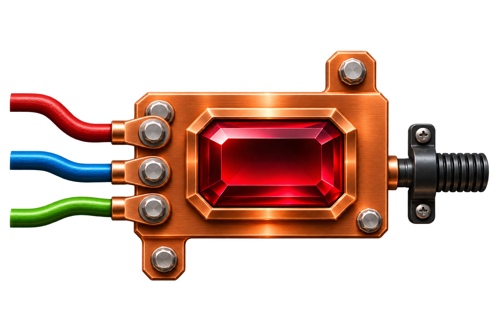

<p align="center">
  
</p>

# BusBar

BusBar is a mountable Rails engine that makes onboarding a client's data easy.
Clients bring CSV (and TSV, XLSX, JSON or NDJSON) files through an in-app
upload, SFTP, a bucket, email or an HTTPS push, either once when they are
onboarded or continuously on a recurring feed. BusBar maps each client's
columns to a schema, validates and stages every row, shows a review screen,
and upserts the result into your app's own models.

The full design lives in [docs/spec.md](docs/spec.md).

> **Status: scaffold.** The engine skeleton, configuration, dummy host app and
> CI are in place. Phase 1 (core pipeline and upload) is next; see
> [Roadmap](#roadmap).

## Stack

- Rails 8 engine, gem `busbar`, Ruby namespace `Busbar`
- PostgreSQL (required: the pipeline uses `COPY`, `jsonb` and partial indexes)
- [acts_as_tenant](https://github.com/ErwinM/acts_as_tenant) for row-level multi-tenancy
- [Statesman](https://github.com/gocardless/statesman) for the run state machine and its audit trail
- Hotwire (Turbo and Stimulus) for the UI, no build step required
- ActiveJob for the pipeline, so Solid Queue, Sidekiq and GoodJob all work

## Installing in a host app

```ruby
# Gemfile
gem "busbar", github: "robertoplancarte/busbar"
```

```ruby
# config/routes.rb
mount Busbar::Engine, at: "/busbar"
```

```ruby
# config/initializers/busbar.rb
Busbar.configure do |c|
  c.tenant_class  = "Account"
  c.tenant_column = :account_id
  c.current_user  = -> { Current.user }
  c.authorize     = ->(user, action, record) { BusbarPolicy.new(user, record).public_send("#{action}?") }
end
```

An install generator (`bin/rails g busbar:install`) that writes the migrations,
initializer and route arrives with phase 1.

## Repository layout

| Path | What it is |
| --- | --- |
| `app/`, `config/`, `lib/` | The engine |
| `spec/` | RSpec suite for the engine |
| `spec/dummy/` | Dummy host app with tenant-scoped `Account` and `User` models, the phase 1 target |
| `extensions/busbar-oneroster/` | The `busbar-oneroster` extension gem (OneRoster 1.2 CSV packages), developed alongside the engine with its own gemspec and Minitest suite |
| `docs/spec.md` | The engine spec |
| `docs/assets/` | Logo files |

`busbar-oneroster` registers itself through the engine's `:busbar` load hook,
which the engine already fires. The extension API it calls
(`Busbar.register_extension`) lands in phase 3, so the gem is not yet added to
the dummy app.

## Development

You need Ruby 3.3 and a running PostgreSQL.

```sh
bundle install
(cd spec/dummy && bin/rails db:prepare)
bin/rspec          # engine specs
bin/rubocop        # lint

cd extensions/busbar-oneroster
bundle install
bundle exec rake test
```

Set `DATABASE_URL` or `PGHOST`/`PGUSER`/`PGPASSWORD` if Postgres is not on the
default local socket.

## Roadmap

1. **Core pipeline and upload.** Schemas, templates, step library, pipeline jobs, generic loader, incremental mode, upload, mapping, review and run screens.
2. **Recurring feeds and SFTP.** Feeds, scheduler, hosted and remote SFTP, bucket pull, email-in, HTTPS push, snapshot modes, thresholds, notifications.
3. **Flexibility.** Database-defined schemas, value maps, PGP, JSON API, view generator, extension API with package runs, busbar-oneroster.
4. **Assistance.** LLM mapping suggester, find-and-replace on staged rows, AWS Transfer Family adapter.

## License

MIT. See [MIT-LICENSE](MIT-LICENSE).
