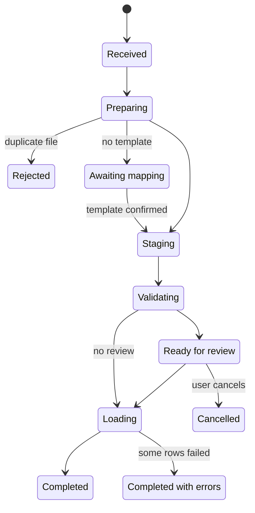

# BusBar engine spec

> Committed copy of the [BusBar engine spec](https://claude.ai/artifact/BRkcGV6cECNVAsTUVMWMDn) as of 1 Nov 2026. The live doc is the source of truth; update this file when it changes.

BusBar is a mountable Rails engine that loads client CSV and Excel files of any record type into a host app, from in-app uploads or SFTP, once or on a recurring feed. It builds on the decisions in [State of the art in B2B client data onboarding](https://claude.ai/artifact/TS3HRViiZ35ijPWJSU4Yaq).

## Scope and non-goals

Version 1 takes a file from any supported channel to upserted host records, with a reusable per-client template, and handles files of several hundred thousand rows.

**In scope**

- CSV, TSV, XLSX, JSON and NDJSON input, any encoding detected and converted to UTF-8
- Channels: in-app upload, HTTPS file push, hosted SFTP (SFTPGo first, swappable), pull from a client's SFTP server or S3, GCS or Azure bucket, email-in, optional PGP decryption
- Any record type, defined as data in the database or in Ruby
- Column mapping, validation, transforms, dedupe, upsert, and a downloadable error file
- One-time imports and recurring feeds with schedules, expected-by alerts and safety thresholds
- Row-level multi-tenancy through acts_as_tenant
- Hotwire and Stimulus UI, plus a JSON API
- Optional AI mapping suggestions behind an interface

**Not in version 1**

- Exports, or syncing data back to clients
- API, webhook or warehouse sources (the channel adapter design leaves room for them)
- XML or fixed-width files
- Free-form code transforms written by users or by AI
- Multi-file imports that join several files into one entity

## Run lifecycle

A run is a state machine stored in `busbar_runs.state`; each transition is recorded with a timestamp and the user, if any.

A run stops for a person only at mapping and review.

One-time uploads always stop at Ready for review; recurring feeds load straight through unless a threshold or schema drift trips. Any stage can also end in `failed` once its job exhausts retries, and a failed run can be resumed from the last completed stage.

**Implementation: Statesman.** Run states use the `statesman` gem, which stores every transition as a row in `busbar_run_transitions` (from, to, metadata such as user id and error, timestamp). That gives the audit trail and per-stage timings without extra code, and its unique `most_recent` constraint stops two jobs from making conflicting transitions at once. The current state is also cached on `busbar_runs.state` in an after-transition hook so lists can filter and index on it. Chunk progress inside a stage stays a counter, not states. AASM was the alternative: simpler, but it keeps only the current state, so history would need a hand-built table.

## Data model

Eight engine tables, all prefixed `busbar_`, all carrying `tenant_id` except where noted. JSON columns are `jsonb` on Postgres, which version 1 requires because of `COPY`, `jsonb` and partial indexes.

| Table | Key columns | Notes |
|---|---|---|
| `busbar_schemas` | `key`, `name`, `version`, `fields` (jsonb), `natural_key` (array), `loader` (string), `source` (`db` or `code`) | `tenant_id` is nullable: null means a global schema every tenant can use. Code-defined schemas are synced in at boot |
| `busbar_templates` | `schema_id`, `name`, `column_map` (jsonb), `transforms` (jsonb), `value_maps` (jsonb), `options` (jsonb: date format, header row, delimiter), `load_mode`, `version` | One client's confirmed mapping. New version on each edit; runs pin the version they used |
| `busbar_feeds` | `template_id`, `channel`, `connection_id`, `path`, `filename_pattern`, `schedule` (cron), `expected_by`, `pgp_mode`, `max_row_drop_pct`, `notify_emails`, `active` | A recurring source. One-time uploads have no feed |
| `busbar_connections` | `kind` (`hosted_sftp`, `remote_sftp`, remote_bucket, email, push), `host`, `port`, `username`, `encrypted_credentials`, `host_key_fingerprint`, `provider_ref` | Credentials use Active Record encryption |
| `busbar_runs` | `feed_id`, `template_id`, `template_version`, `state`, `source_path`, `checksum`, `row_count`, `chunk_count`, `chunks_done`, counts (`created`, `updated`, `unchanged`, `skipped`, `failed`), `dry_run`, `started_at`, `finished_at`, `error` | Raw file and error file attached via ActiveStorage. Unique on (`feed_id`, `checksum`) |
| `busbar_staged_rows` | `run_id`, `row_number`, `raw` (jsonb), `data` (jsonb), `natural_key_digest`, `status`, `errors` (jsonb), `action` (`create`, `update`, `unchanged`, `skip`) | Bulk-written. Partitioned by `run_id` range or dropped after retention period |
| `busbar_seen_files` | `feed_id`, `path`, `size`, `mtime`, `checksum` | Remembers files pulled from client servers we cannot move or delete |
| `busbar_value_maps` | `template_id`, `field`, `source_value`, `target_value`, `confirmed_by_id` | Learned enum mappings, reused by AI and humans |

Row errors live inside `busbar_staged_rows.errors` rather than their own table, which keeps the write path to a single bulk insert per chunk. A ninth table, `busbar_run_transitions`, holds Statesman's state history for runs (see Run lifecycle).

## Schemas, templates and the step library

A schema says what a record must look like; a template says how one client's file becomes that record. Both are plain JSON, so they can be stored, versioned, diffed and generated by an AI suggester.

**Schema** (stored in `busbar_schemas.fields`):

`json
{
  "key": "employee",
  "natural_key": ["external_id"],
  "loader": "active_record:Employee",
  "fields": [
    {"name": "external_id", "type": "string", "required": true, "synonyms": ["emp id", "employee number"]},
    {"name": "email", "type": "email", "required": true},
    {"name": "hired_on", "type": "date"},
    {"name": "terminated_on", "type": "date"},
    {"name": "status", "type": "enum", "values": ["active", "leave", "terminated"]},
    {"name": "manager_external_id", "type": "string", "references": {"schema": "employee", "field": "external_id"}}
  ],
  "rules": [{"validator": "date_order", "args": {"before": "hired_on", "after": "terminated_on"}}]
}
`

The same schema in the optional Ruby DSL, which syncs to that JSON at boot:

`ruby
Busbar.define_schema :employee do
  natural_key :external_id
  loader :active_record, model: "Employee"

  field :external_id, :string, required: true, synonyms: ["emp id", "employee number"]
  field :email, :email, required: true
  field :hired_on, :date
  field :status, :enum, values: %w[active leave terminated]
end
`

**Template** (one per client per schema):

`json
{
  "column_map": {"Emp #": "external_id", "Work Email": "email", "Start": "hired_on", "Status": "status"},
  "transforms": [
    {"field": "email", "step": "downcase"},
    {"field": "hired_on", "step": "parse_date", "args": {"format": "%m/%d/%Y"}},
    {"field": "status", "step": "value_map"}
  ],
  "options": {"header_row": 1, "delimiter": ",", "skip_blank_rows": true},
  "load_mode": "incremental"
}
`

**Step library.** Field types, validators and transforms are registered Ruby classes referenced by name, so templates never contain code.

| Kind | Built in | Extend with |
|---|---|---|
| Types | string, integer, decimal, boolean, date, datetime, email, phone, enum, money | `Busbar.register_type` |
| Validators | required, format, length, range, enum, unique_in_file, references, date_order | `Busbar.register_validator` |
| Transforms | strip, downcase, upcase, titleize, parse_date, parse_boolean, normalize_phone, split, concat, default, value_map, lookup | `Busbar.register_transform` |

A field type implies its own cast and validation, so `email` both normalizes and checks format without extra steps.

## Pipeline execution

Each run moves through ActiveJob jobs that are idempotent per run and per chunk, so any job can be retried without double-writing. The engine depends only on ActiveJob; Solid Queue, Sidekiq and GoodJob all work.

| Job | Does | Fan-out |
|---|---|---|
| `Busbar::PrepareJob` | Checksum, reject duplicates, PGP decrypt, detect encoding and transcode to UTF-8, convert XLSX to CSV, detect JSON vs NDJSON, detect delimiter and header, count rows, sample 20 rows for mapping | 1 per run |
| `Busbar::StageJob` | Stream the file in chunks of 5,000 rows (`smarter_csv`), apply the column map, bulk-write `raw` and `data` into `busbar_staged_rows` with `COPY` | 1 per run, streaming |
| `Busbar::ValidateChunkJob` | Transforms and field and row validators in Ruby, written back with one `UPDATE ... FROM (VALUES ...)` per chunk | 1 per chunk, parallel |
| `Busbar::FileChecksJob` | Set-based SQL over staged rows: duplicate natural keys in the file, references to existing records, row-count drift against the last run | 1 per run, after all chunks |
| `Busbar::DiffJob` | Join staged rows against the target table on natural key to label each row create, update or unchanged | 1 per run |
| `Busbar::LoadChunkJob` | Upsert valid rows through the loader in batches of 1,000 | 1 per chunk |
| `Busbar::FinalizeJob` | Totals, error CSV streamed from staged rows to ActiveStorage, notifications, file archiving | 1 per run |

**Coordination.** Chunk jobs increment `busbar_runs.chunks_done` atomically; the job that brings it to `chunk_count` enqueues the next stage. No batch-job feature of a specific backend is required.

**Memory and speed targets.** Peak memory per worker stays under 300 MB regardless of file size, because rows are never held beyond one chunk. Target: 500,000 rows of 30 columns staged and validated in under 5 minutes on 4 workers. These are goals to confirm with benchmarks, not measurements.

**Pause points.** A run stops in `awaiting_mapping` when no template matches, and in `ready` after validation when the feed or upload is set to review first (always for one-time uploads, configurable for feeds). Recurring feeds with a confirmed template and no threshold breach load straight through.

## Loading

Loaders are the only code that writes host records. The engine ships a generic ActiveRecord loader that covers most schemas, and hosts register their own for records with business logic.

`ruby
class EmployeeLoader < Busbar::Loader
  # rows: array of hashes already validated and transformed
  # context: tenant, run, load_mode
  def load(rows, context)
    Employee.upsert_all(
      rows.map { |r| r.merge(account_id: context.tenant.id) },
      unique_by: %i[account_id external_id],
      record_timestamps: true
    )
  end
end

Busbar.register_loader :employee, EmployeeLoader
`

**Generic loader rules**

- `active_record:Employee` maps schema fields to model attributes with the same name, or through an `attribute_map` on the schema.
- It always writes the tenant column itself, because `upsert_all` bypasses acts_as_tenant's default scope.
- The unique index for `unique_by` must be (`tenant column` + natural key). The install check refuses a schema whose target table lacks that index.
- It does not run model validations or callbacks. Schemas that need them should use a custom loader that calls `save` per row, at a known speed cost.

**Load modes** (per template, overridable per feed)

| Mode | Rows in file | Records missing from file |
|---|---|---|
| `incremental` | Create or update | Untouched |
| `snapshot_deactivate` | Create or update | Loader's `deactivate(keys)` is called, for example setting `status: inactive` |
| `snapshot_delete` | Create or update | Loader's `delete(keys)` is called; requires an explicit opt-in flag |
| `create_only` | Create; existing keys skipped | Untouched |

Snapshot modes are blocked when the row count drops more than `max_row_drop_pct` (default 20%) from the previous successful run; the run waits in `ready` for a person to approve.

**Failure handling.** Invalid rows never reach the loader. A batch that raises is retried by ActiveJob; after the final retry its rows are marked `failed` with the exception message, and the run finishes as `completed_with_errors` rather than rolling back batches that already succeeded.

## Channels

Every channel ends the same way: a file in ActiveStorage and a call to `Busbar::Runs.create_from(blob, tenant:, feed:)`. Nothing downstream knows which channel delivered it.

**In-app upload.** ActiveStorage direct upload to the configured service, then the controller creates the run. Max size defaults to 500 MB, configurable.

**Hosted SFTP.** A provider adapter behind `Busbar.sftp_provider`:

`ruby
class Busbar::Sftp::Provider
  def create_user(connection, public_key:) = raise NotImplementedError
  def rotate_key(connection, public_key:)  = raise NotImplementedError
  def disable_user(connection)             = raise NotImplementedError
  def landing_prefix(connection)           = raise NotImplementedError # bucket key prefix
end
`

- `Busbar::Sftp::Sftpgo` (version 1) manages users through the SFTPGo REST API, each chrooted to `<tenant>/<connection>/` on an S3-compatible bucket.
- `Busbar::Sftp::AwsTransfer` (later) does the same through the AWS SDK.
- Arrival detection is provider-agnostic: `Busbar::BucketWatchJob` lists new keys under each landing prefix every minute (or receives a bucket event where available), waits until a key's size is stable across two checks, attaches it as a blob, and moves it to `processed/` or `failed/`.

**Client-hosted SFTP.** `Busbar::RemotePullJob` runs on each feed's cron schedule with `net-sftp`.

- Key auth is preferred: the engine generates a keypair per connection and shows the public key to the client. Password auth is supported, encrypted at rest.
- The server's host key fingerprint is pinned on first connect and checked on every pull.
- Files matching `filename_pattern` are downloaded if their (path, size, mtime) is not in `busbar_seen_files`. If the connection allows writes, files are renamed to `.processed` after download.

**Client-hosted buckets.** `Busbar::BucketPullJob` reads from a client's S3, GCS or Azure Blob container on the feed schedule, using the official SDKs (`aws-sdk-s3`, `google-cloud-storage`, `azure-storage-blob`). Credentials are stored encrypted; for S3 the preferred setup is a cross-account IAM role the client grants us, so no long-lived keys are stored. Seen-file tracking works like remote SFTP, using the object's ETag in place of size and modified time.

**Email-in.** Each feed or tenant gets an address such as `feed-7f3a@busbar.example.com`, handled by an Action Mailbox mailbox in the engine. Attachments matching the feed's pattern become runs; the sender must be on the feed's allowed-sender list, and anything else is bounced with a reason. Attachment size is capped (default 25 MB) because email is meant for small clients.

**HTTPS file push.** `POST /busbar/api/v1/feeds/:id/files` accepts a multipart file, or `POST .../uploads` returns a presigned URL for large files followed by a `complete` call. Authentication is a per-feed API token (hashed at rest, rotatable) in a bearer header. The response returns the run id so client scripts can poll `GET /busbar/api/v1/runs/:id` for the outcome.

**JSON and NDJSON.** NDJSON is streamed one line per record. A JSON file must be an array of objects, or an object with one array (the path is set in the template); it is streamed with a SAX-style parser (`oj`'s `Oj::Parser` or `yajl-ruby`) so large files never load whole. Nested objects are flattened to dot paths (`address.city`) that the column map uses like CSV headers; arrays inside a record are kept as JSON values for a transform to handle.

**PGP.** Off by default. When a feed's `pgp_mode` is `required` or `auto` (decrypt files ending `.pgp`, `.gpg`, `.asc`), `PrepareJob` decrypts with GnuPG through the `gpgme` gem into a temporary file before parsing. The engine's private key is configured per host, stored encrypted; clients receive the public key from the feed settings page. Signature verification against a client key is optional per feed.

**Schedules.** A single recurring job (`Busbar::SchedulerJob`, every minute, registered with the host's backend) enqueues due pulls and checks `expected_by` deadlines, so the engine does not depend on one backend's cron feature.

## Front end

The UI is server-rendered Hotwire: Turbo Frames for each panel, Turbo Streams for live progress, and small Stimulus controllers for interaction. No build step is required; controllers ship through importmap and also work with jsbundling.

| Screen | Route | What it does |
|---|---|---|
| Imports list | `GET /busbar/runs` | Runs for the current tenant with state, counts, channel, filter by feed |
| New import | `GET /busbar/runs/new` | Pick schema (or template), drop a file, direct upload with progress |
| Map columns | `GET /busbar/runs/:id/mapping` | Each source column with 5 sample values, a select of target fields, confidence from synonyms or AI, unmapped required fields flagged; save as template |
| Review | `GET /busbar/runs/:id/review` | Totals (create, update, unchanged, error), a paginated grid of rows with errors highlighted, inline cell edit, filter by error type, download error CSV, approve load |
| Run detail | `GET /busbar/runs/:id` | Live progress bar and stage, final summary, raw and error file downloads |
| Feeds | `/busbar/feeds` | Create and edit feeds: channel, template, schedule, expected-by time, load mode, thresholds, PGP, notify list |
| Connections | `/busbar/connections` | Hosted SFTP credentials and public keys, remote server details, test connection button |
| Schemas | `/busbar/schemas` | Admin-only builder for database-defined schemas |

**Stimulus controllers**

- `busbar--upload`: direct upload progress, file type and size checks before upload
- `busbar--mapping`: live required-field check, prevents mapping two columns to one field, accept-all-suggestions button
- `busbar--cell-edit`: click a cell, edit, submit a Turbo Stream update that re-validates that row only
- `busbar--run-progress`: subscribes to the run's Turbo Stream channel
- `busbar--sftp-test`: runs a connection test and shows the result

**Large-file review.** The grid never loads all rows; it pages 100 rows at a time from `busbar_staged_rows`, defaulting to rows with errors. Fixing the same value in many rows uses a find-and-replace action that runs as a set-based update on staged rows.

**Customizing.** Hosts override any view with `rails g busbar:views`, set a layout with `Busbar.layout`, and style with their own CSS; engine markup uses plain semantic classes prefixed `busbar-`. Authorization goes through a host-provided `Busbar.authorize` callable so the engine works with Pundit, CanCanCan or custom checks.

**JSON API.** Every screen's action has a JSON equivalent under `/busbar/api/v1`, authenticated by the host, for hosts that build their own UI.

## Multi-tenancy and security

Tenancy is row-level through acts_as_tenant, and every path that runs outside a request sets the tenant explicitly.

- `Busbar.tenant_class = "Account"` and `Busbar.tenant_column = :account_id` configure the host's tenant. Engine models call `acts_as_tenant :tenant, class_name: Busbar.tenant_class`.
- `Busbar::ApplicationJob` serializes the tenant id and wraps `perform` in `ActsAsTenant.with_tenant`. A job enqueued without a tenant raises.
- Loaders receive `context.tenant` and must write it into every row; the generic loader does this, and the `unique_by` index must lead with the tenant column.
- `busbar_schemas` with a null tenant are global; queries use `unscoped` only in the schema lookup that merges global and tenant schemas.
- Each SFTP user and remote connection belongs to one tenant, and its landing prefix starts with the tenant id, so a misrouted file cannot cross tenants.

**Security**

- Remote passwords, private keys and the PGP private key use Active Record encryption; they are never rendered back to the UI after save.
- Hosted SFTP users get key auth by default, optional IP allowlists, and no shell.
- Uploaded files are checked by content (not extension) and size before processing. Formula-looking cells (`=`, `+`, `-`, `@`) are escaped in generated error CSVs to prevent CSV injection.
- Raw files, staged rows and error files are deleted after a retention period (default 30 days) by `Busbar::RetentionJob`; the run record and counts stay for audit.
- AI suggestions send headers and at most 20 sample values per column, with optional masking, and are off unless a tenant enables them.
- Every template change and every approved load records the user who made it.

## Host integration

A host adds the gem, runs one generator, and mounts the engine. Everything else is an initializer.

`ruby
# Gemfile
gem "busbar"

# bin/rails g busbar:install  -> migrations, initializer, route

# config/routes.rb
mount Busbar::Engine, at: "/busbar"

# config/initializers/busbar.rb
Busbar.configure do |c|
  c.tenant_class   = "Account"
  c.tenant_column  = :account_id
  c.current_user   = -> { Current.user }
  c.authorize      = ->(user, action, record) { BusbarPolicy.new(user, record).public_send("#{action}?") }
  c.layout         = "application"
  c.storage_service = :amazon             # ActiveStorage service for raw and error files
  c.sftp_provider  = :sftpgo
  c.sftpgo         = { url: ENV["SFTPGO_URL"], api_key: ENV["SFTPGO_API_KEY"], bucket: "client-drops" }
  c.pgp_private_key = Rails.application.credentials.dig(:busbar, :pgp_private_key)
  c.chunk_size     = 5_000
  c.retention      = 30.days
  c.mapping_suggester = Busbar::Suggesters::Synonyms   # or an AI suggester
end
`

**Mapping suggester interface.** Suggesters are chained; the first confident answer wins and a person always confirms.

`ruby
class Busbar::Suggester
  # headers: ["Emp #", "Work Email", ...]
  # samples: { "Emp #" => ["1001", "1002", ...], ... }
  # schema:  Busbar::Schema
  # returns: [{ source: "Emp #", field: "external_id", confidence: 0.92, reason: "..." }, ...]
  def suggest(headers:, samples:, schema:) = raise NotImplementedError
end
`

Version 1 ships three: `Exact` (normalized name match), `Synonyms` (schema synonyms plus past templates for the same tenant), and `Llm`, which calls a configurable model provider through a host-supplied client and is off by default. The same interface later covers value-map suggestions for enum fields.

**Events.** The engine emits `ActiveSupport::Notifications` events (`run.created.busbar`, `run.completed.busbar`, `run.failed.busbar`, `feed.missed.busbar`) so hosts can hook in their own side effects, such as reindexing search after a load.

**After-ingestion service.** The engine never sends emails or runs side effects on imported records itself. Once a run's load finishes, it calls a host service the host extends, so inviting users, syncing search or notifying billing all live in the host.

`ruby
class Busbar::AfterIngestion
  # Called once per run after loading, inside Busbar::AfterIngestionJob
  # with the run's tenant set. Default implementation does nothing.
  def call(run, context) = nil
end

# Host app
class UserIngestionHandler < Busbar::AfterIngestion
  def call(run, context)
    context.created.find_each do |row|          # streams staged rows, never all at once
      UserMailer.invitation(row.record).deliver_later
    end
    context.deactivated_keys.each_slice(1_000) { |keys| SessionRevoker.call(keys) }
  end
end

Busbar.configure do |c|
  c.after_ingestion = { user: "UserIngestionHandler" }   # per schema; :default for all
end
`

- `context` exposes `created`, `updated`, `unchanged` and `failed` as streamed scopes over staged rows, `deactivated_keys` for snapshot modes, `record` lookup by natural key, the template, the feed and the user who approved the load.
- It runs in its own job after `Loading`, so a slow or failing handler never blocks or rolls back the load. A handler that raises is retried; after the final retry the run is flagged `after_ingestion_failed` and the ops address is notified.
- Handlers can be re-run from the run detail page, so they should be idempotent; the context carries the run id to help with that.

## Extensions

Domain standards ship as separate gems that plug into the engine; the engine itself stays standard-agnostic. `busbar-oneroster` is the reference extension.

**Registration.** The engine runs `ActiveSupport.run_load_hooks(:busbar, Busbar)` after it boots. An extension gem hooks in with `ActiveSupport.on_load(:busbar)`, so adding it to the Gemfile is the whole install.

`ruby
Busbar.register_extension(:oneroster, version: "0.1.0") do |ext|
  ext.schema :oneroster_users do |s|        # same builder as Busbar.define_schema
    s.natural_key :sourced_id
    s.scope_key :source_system              # limits snapshot deactivation to one source
    s.field "given_name", :string, required: true
    s.field "primary_org_sourced_id", :string, references: :oneroster_orgs
  end
  ext.template :oneroster_users, schema: :oneroster_users, column_map: {...}, transforms: [...]
  ext.transform :oneroster_row, Busbar::OneRoster::RowTransform
  ext.package_handler Busbar::OneRoster::PackageHandler
end
`

**What an extension can register**

| Piece | Interface | Example |
|---|---|---|
| Schemas | Schema builder; adds `scope_key` for snapshot scoping | One per OneRoster file |
| Preset templates | Same JSON as client templates; marked read-only | Fixed headers, so no mapping step |
| Types, validators, transforms | Classes with `call(row, context)`; a transform may set `row.action` to `:upsert`, `:deactivate` or `:skip` | `oneroster_row` sets `:deactivate` for `tobedeleted` rows |
| Package handlers | `self.match?(path, filename:)`, `open` returns a plan, `close` | Zip with `manifest.csv` |
| Parsers | `self.match?`, `each_row` | Later: fixed-width, EDI |
| Channels | Same adapter as built-in channels | Later: OneRoster REST pull |

**Packages.** Some standards deliver several related files at once. A package handler turns one received file into a parent run with ordered child runs, each a normal run with its own schema, template and load mode. Children run one after another in plan order, so references resolve against files already loaded; the parent finishes when every child has, and fails as a whole if the plan returns errors. This is the only engine change OneRoster needs beyond the registration API, and it lands in phase 3 with the extension API.

**busbar-oneroster 0.1** covers the eight rostering files of OneRoster 1.2 (orgs, academic sessions, courses, classes, users, demographics, roles, enrollments). Bulk files load as `snapshot_deactivate` scoped to the manifest's source system; delta files load incrementally with per-row deactivation. Hosts register a loader for each schema they want written to their models. Gradebook and resource files, OneRoster 1.1 and the REST binding are not covered yet.

## Observability, notifications and testing

**Notifications** go to each feed's notify list by email (ActionMailer, host-overridable) and through the events above.

| Trigger | Who hears | Default |
|---|---|---|
| Run completed | Uploader; feed notify list | On for uploads, off for feeds |
| Run completed with errors or failed | Uploader; feed notify list; internal ops address | On |
| Run waiting for review (mapping changed, threshold breached) | Feed notify list; internal ops address | On |
| Expected file missing by `expected_by` | Feed notify list; internal ops address | On |
| Schema drift (unknown or missing required columns) | Feed notify list; internal ops address | On |
| Remote SFTP connection failing 3 pulls in a row | Internal ops address | On |

**Run history.** Each run keeps its state transitions with timestamps, so the run detail page and the JSON API show how long each stage took. Structured log lines carry `run_id` and `tenant_id`.

**Testing**

- A dummy host app inside the engine (`spec/dummy`) with acts_as_tenant, two tenants and two schemas, running on Postgres in CI.
- Fixture files covering encodings (UTF-8 with BOM, Windows-1252), delimiters, quoted newlines, XLSX, ragged rows, empty files, duplicate keys, and a PGP-encrypted file.
- Unit tests per type, validator and transform; integration tests per job; a full end-to-end test per channel.
- SFTP tests run against an SFTPGo container in CI for both hosted and remote-pull paths.
- A tenant-isolation test suite that runs every job and loader with two tenants sharing natural keys.
- A benchmark task (`rake busbar:bench ROWS=500000`) that tracks the speed and memory targets.

## Delivery phases and open questions

Build in four phases, each shippable on its own, so a real client can load data after phase 1.

1. **Core pipeline and upload.** Engine skeleton, install generator, tenancy, CSV, XLSX, JSON and NDJSON parsing, code-defined schemas, templates, step library, all pipeline jobs, generic loader, incremental mode, upload, mapping, review and run screens.
2. **Recurring feeds and SFTP.** Feeds, scheduler, hosted SFTP with the SFTPGo adapter, remote SFTP and bucket pull, email-in, HTTPS file push, seen-file tracking, snapshot modes and thresholds, notifications.
3. **Flexibility.** Database-defined schemas and the schema builder, value maps, PGP, JSON API, custom view generator, extension API with package runs, busbar-oneroster.
4. **Assistance.** LLM suggester for columns and enum values, find-and-replace on staged rows, AWS Transfer Family adapter.

**Later: identity providers.** SAML and OIDC are sign-in protocols that create users one at a time at login, so they stay in the host's auth stack (for example `omniauth-saml`, `omniauth_openid_connect`). The bulk-provisioning standard is SCIM 2.0, which Okta, Entra ID and OneLogin use to push user creates, updates and deactivations. A phase 5 could add:

- A record-level path, `Busbar.ingest_record(schema: :user, attributes:, tenant:)`, that reuses schema validation, value maps, the loader and the after-ingestion service but skips files, staging and chunking. The host's SSO just-in-time creation calls it, so users made at login follow the same rules as imported ones.
- A SCIM channel: per-tenant `/scim/v2/Users` and `/Groups` endpoints with bearer tokens, mapping SCIM attributes onto the `user` schema through a template, likely built on an existing SCIM server gem such as `scimitar` rather than from scratch.
- Identity linking: store the IdP subject (SAML NameID or OIDC `sub`) next to `external_id`, so a user imported from a CSV is matched, not duplicated, on first SSO login.

**Later: more channels and formats.** Channels and parsers are both adapters, so each addition below plugs into the same pipeline.

| Addition | Kind | Effort | Why |
|---|---|---|---|
| Fixed-width | Format | Medium | Still common in payroll, banking and insurance feeds |
| Google Drive, SharePoint, Dropbox folders | Channel | Medium | Frequent client ask; OAuth per tenant |
| SaaS connectors via a unified API (Merge, Finch) or Airbyte | Channel | Medium to high | Pull from HRIS, CRM, accounting without files |
| Domain standards: EDI X12 (e.g. 834 enrollment), HL7 FHIR, OneRoster, ISO 20022 | Format | High | Only if the product enters that industry |

Bucket pull, email-in, HTTPS file push, JSON and NDJSON moved into version 1 (1 Nov).

**Phase 1 target: client users.** With no host app chosen, phase 1 builds against the dummy app's `Account` and `User` models and ships a ready-made `user` schema hosts can adopt.

- Fields: `external_id`, `email`, `first_name`, `last_name`, `role`, `status`, `title`, `department`, `manager_email`, `phone`.
- Natural key: `external_id` when the client has one, otherwise lowercased `email`; chosen per template.
- `role` and `status` map through value maps, so "Admin", "administrator" and "ADM" land on the same role.
- `manager_email` resolves to a user in the same file or already in the tenant, which exercises the `references` check.
- Passwords are never imported. `snapshot_deactivate` suspends users missing from an HR feed instead of deleting them.

**Open questions**

- [x] Postgres is required (confirmed 1 Nov).
- [x] First target: client users, built in the dummy app since no host app is chosen yet (confirmed 1 Nov).
- [x] Gem name: `busbar`, shown as BusBar, with the `Busbar` Ruby namespace (confirmed 1 Nov).
- [ ] Open source the engine, or keep it private to our apps?
- [ ] Should a one-time import with zero errors skip review and load straight away?
- [ ] Invitations and other side effects are left to the host through the after-ingestion service (confirmed 1 Nov).
